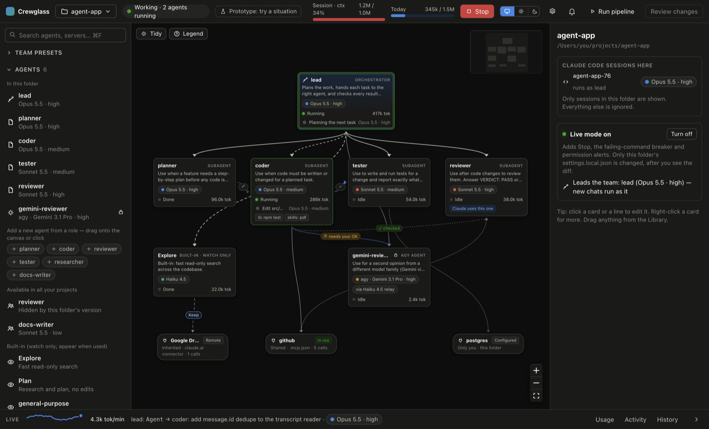

# Crewglass

**See, design and safeguard your Claude Code agent team.** A local-only macOS app: pick a folder, and Crewglass shows
what Claude Code is doing there (sessions, subagents, MCP servers, models, effort and tokens) and can step in
when something goes wrong. Nothing leaves your Mac.



- **Watch:** every agent and subagent as a card, with its model, effort, status and what it's doing right now. Links
  show who handed work to whom. Usage is shown in tokens (input + output) per session, agent, model and day, plus cache
  traffic.
- **Safeguard (Live mode):** **Stop** Claude at its next step, **pause a command that keeps failing**, get a pop-up when
  Claude waits for your permission, run your **checks** (tests, lint) after an agent edits code and send failed work
  back to be fixed, and approve calls between agents.
- **Design:** build your team on a canvas, pick models and effort, and save it as real Claude Code files. You see the
  exact diff first, every save is backed up, and **Undo** puts it all back.
- **Private by design:** no network code, no prompt or reply text stored, and only the folder you choose is read.

## Download

**[Download the latest .dmg from Releases](../../releases/latest)** (Apple Silicon Macs: M1 and later).

1. Open `Crewglass-<version>-arm64.dmg` and drag **Crewglass** onto **Applications**.
2. The first time you open it, macOS blocks it, because the app isn't signed with an Apple Developer ID. Go to
   **System Settings → Privacy & Security**, scroll down and click **Open Anyway**. This is needed only once.
3. Pick a folder you use Claude Code in. The setup guide walks you through Live mode and limits.

**You need** [Claude Code](https://docs.anthropic.com/en/docs/claude-code) installed. agy agents (Gemini as a team
member) also need agy (Google's Antigravity CLI) and Node.

## Build from source

```bash
npm install          # once (downloads the build tools; the app itself never goes online)
npm run dist         # builds release/mac-arm64/Crewglass.app
ditto "release/mac-arm64/Crewglass.app" "/Applications/Crewglass.app"
open "/Applications/Crewglass.app"
```

An app built on your own Mac opens with no warning. It starts at login, quietly in the menu bar, so the safeguards are
there whenever Claude runs.

## Using it

- **⌘N** opens another folder in a new window. Closing a window keeps its folder watched from the menu bar ◆;
  *File → Stop Watching This Folder* ends that. **⌘F** searches the Library; **⌘Z / ⇧⌘Z** undo and redo canvas edits.
- **Usage limits** are per session and per folder per day, in tokens (input + output). You get warnings at 80% and
  100%. Nothing is ever blocked.
- **Uninstall** (*Crewglass → Uninstall…*): shows a checklist, then removes Live mode from every folder it touched
  (restoring each `settings.local.json` exactly), unregisters the agy bridge, deletes its data and quits. Your agent
  files, `.mcp.json` and team maps are kept. Then drag the app to the Trash.

## The designer

Add agents from the Library (role templates, models, team presets), connect them, pick models and effort, make one
the orchestrator, add MCP servers. Nothing is written until you open **Review changes**, which shows every file diff.
Then **Save** backs up the old files and writes:

- agents → `.claude/agents/<name>.md` (existing files are edited in place; unknown fields and comments are kept)
- the team map → `.claude/rules/crewglass-team.md` (Claude loads it in every session) and `/workflow`
- the orchestrator (and its effort — see below) and disabled agents → `.claude/settings.local.json` (personal, git-ignored)
- project MCP servers → `.mcp.json` with `${VAR}` references; private ones through `claude mcp add`

**Who leads:** by default your **Claude Code chat** (VS Code or terminal) leads the team — the chat card on top hands
work to your agents, and team presets never create an orchestrator agent. Type `/workflow <task>` for the full
plan → hand off → verify steps. If you **Make orchestrator** on an agent instead, every *new* chat in the folder runs
as it, starting on its model and effort (an open chat keeps running as it was); **Let the chat lead** goes back. The
agent an open chat runs as has a **double border**. What you type always goes straight to the chat. A model or effort you pick
in the chat (`/model`) still wins for that chat, and the orchestrator card shows **chat now: …** when they differ.
Claude Code can't start a chat at max effort, so an orchestrator set to max starts chats at xhigh.

The **secret guard** blocks saving anything that looks like a key into a file shared through git. **Undo last save**
puts every file back. A team preset only adds what's missing; it never removes your agents.

**Direct calls between agents** (Live mode): a subagent calling another agent must give a `Reason:` line. Links you
drew as *Allowed* go straight through; the orchestrator's `Allowed calls:` grants too. Calls to costly agents (Opus at
high effort or above, agy/Gemini) wait up to 2 minutes for your OK in the 🔔 inbox, then go to the orchestrator.
Anything else goes to the orchestrator as a `REQUEST`. If Crewglass is closed, Claude Code asks you itself.

## Live mode

Turn it on from the panel on the right. Crewglass shows the exact change first: it adds
its hook to **only** that folder's `.claude/settings.local.json` (personal and git-ignored). Then:

- **Stop** (top bar, ⌘.) halts Claude at its next step; your next message clears it.
- A command that **fails 3 times in a row** with no file changes in between is **paused**, and you choose: let the
  orchestrator handle it, give instructions, allow retries, or stop.
- If Claude waits **20 s** for your permission, you get a pop-up.
- Each new chat starts with a one-line note for you — e.g. *Crewglass: this chat runs as lead · starts on Opus 5.5 ·
  high · hands work to planner, coder, reviewer*. Claude never reads it.

If Crewglass is closed, the hook allows everything and Claude works normally. Turning Live mode off removes only
Crewglass's entries — the file goes back byte-for-byte when nothing else changed.

## Checks

Drag a check from the Library onto an agent: `npm test`, `npm run lint`, `tsc`, or your own command (one command, no
shell). With Live mode on, when that agent **changed files** and finishes, Crewglass runs its checks in the folder.
A failure sends the agent back with the last lines of output — at most **2 fix rounds** — then you get an inbox card and
the orchestrator is told. Links show ✓ / ✗ fix round n/2 / ⏳. A **reviewer verdict** check is a "checked by" link: the
reviewer answers `VERDICT: PASS|FAIL`, and only that word is read.

Checks can also go **on a hand-off line** (drag a check onto the line, or use the link's panel): then they check the
receiving agent's work whenever that particular agent handed it over.

Check commands live in Crewglass's private data, never in the repo, and each new one is confirmed in Review changes
before it can run. Checks run without a shell, with a 5-minute limit, and npm/npx are kept offline. (A confirmed
`npm test` runs the project's own test script — confirm checks only in projects you trust.)

The 🔔 inbox also warns (no pop-up) when **Claude may be stuck** (5+ failed tool calls in 10 minutes), when an agent is
given the **same task 3+ times** in one turn, when an **MCP server's process dies**, and every +25% past a limit.
With Live mode on, those warnings let you hand it to the orchestrator, send instructions, or stop Claude. Pop-ups that
arrive within 10 seconds of each other are grouped into one.

**Mac notification when Claude finishes:** whenever Claude in a watched folder finishes a task and goes idle, macOS
shows "Claude finished in <folder>". Not while a Crewglass window is in front.

## agy agents (Gemini)

Drag a Gemini model from the Library onto the canvas to make an **agy agent**: a small Haiku "relay" subagent whose only
tool is Crewglass's agy bridge. When you save, Crewglass registers the bridge **privately for that folder**
(`claude mcp add --scope local crewglass-agy …`). The bridge runs `agy -p … --sandbox` with Gemini models only, and
adds one numbers-only line to each answer so the card can show the real Gemini model, time and tokens (Google's quota,
counted apart from Claude's). agy sends the task to Google — that's agy's own data flow, not Crewglass's.

agy agents need Node (`/opt/homebrew/bin/node`) and agy (`~/.local/bin/agy`). **Refresh** in the Library runs
`agy models` once, only when you click it. More than 3 agy calls in one turn, or a relay that answers without asking
Gemini, shows up in the 🔔 inbox. Connectors (claude.ai, plugins) are signed in with `/mcp` in Claude Code; Crewglass
only shows the ones Claude uses here.

## Development

```bash
npm install          # once
npm run build        # build the app
npm start            # run it from the repo (keeps watching from the menu bar when its window is closed)
npm run dev          # development mode with live reload
```

Other commands:

| Command | What it does |
|---|---|
| `npm run build:hook` | Rebuild the Swift hook helper and copy the agy bridge (`out/bin/crewglass-hook`, `out/bin/agy-bridge.mjs`) |
| `npm run dist` | Build `Crewglass.app` |
| `npm run icon` | Redraw the app icon (`build/icon.icns`) |
| `npm run typecheck` | TypeScript check |
| `npm run prototype` | The clickable design prototype with fake data, opened in your browser |

## What it reads — and never reads

It reads only Claude Code's own records for the folder you pick (session status files, transcripts, agent files,
MCP config names) and the process list (program names only). It never reads `~/.gemini`, the Claude desktop app,
browser data, other folders' transcripts, or credential files. Prompt and reply text is never stored.
Details: [docs/PLAN.md §3.2](docs/PLAN.md).

App data lives in `~/Library/Application Support/Crewglass/` (settings, the hook helper, the socket, backups of
`settings.local.json` taken before Live mode changed it, and backups from every Save). Turn Live mode off in each
folder before deleting it.

## If Claude Code updates

A small "Unknown fields detected" box appears at the bottom-left when Claude Code's files change. It names the
fields and the file in this repo to update.

## Project layout

| Path | What's there |
|---|---|
| `src/main/` | Electron main process: folder watcher (`deck.ts`), transcript reader, Live mode (`live/`), saving (`writers/`), checks |
| `src/renderer/` | The window: React UI, canvas, state; `mock/` holds the fake data for the prototype |
| `src/preload/` | The only bridge between the window and the app (a fixed list of named calls) |
| `src/shared/` | Types, model catalog, team map and file formats used by both sides |
| `hook/main.swift` | The hook helper Claude Code runs on each event (Live mode) |
| `resources/agy-bridge/` | The MCP server behind agy agents |
| `scripts/` | Build and packaging |
| `docs/` | [Design plan](docs/PLAN.md) |

## License

[MIT](LICENSE) © 2026 Shirish-012
